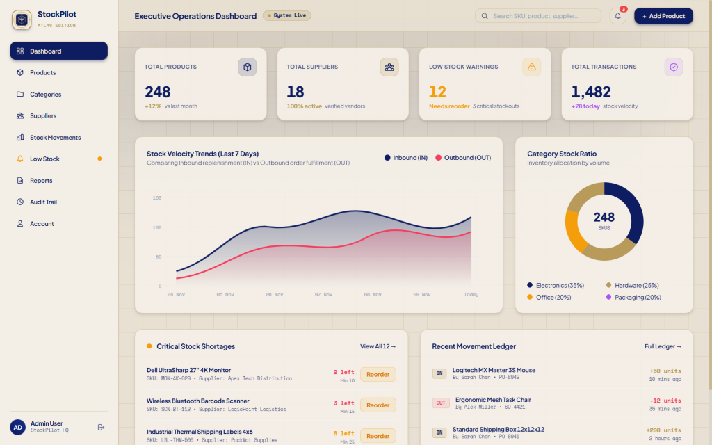
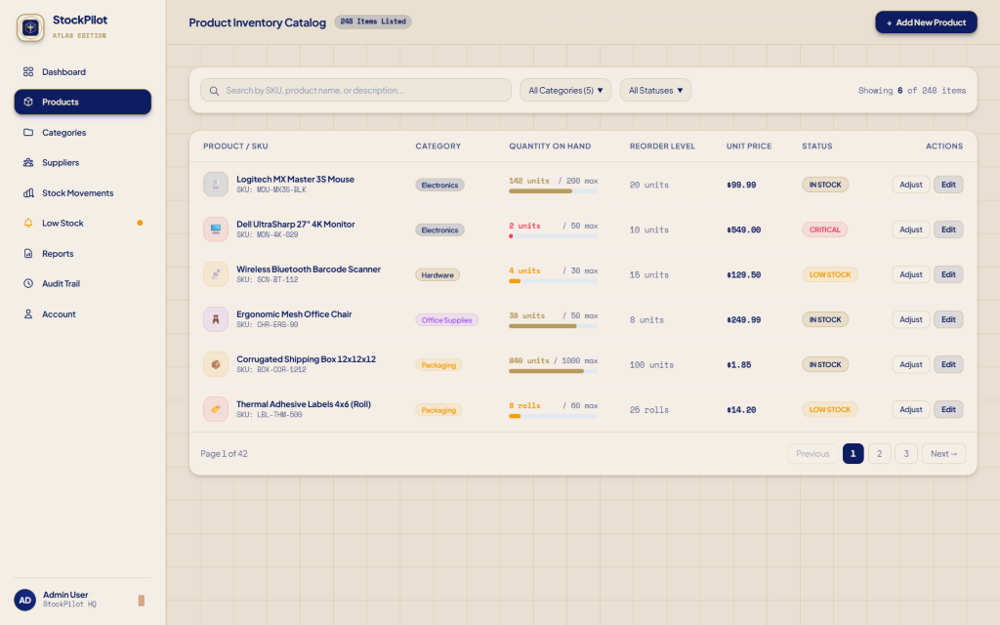
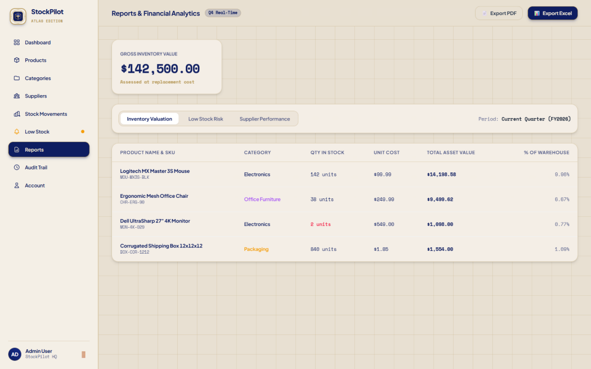
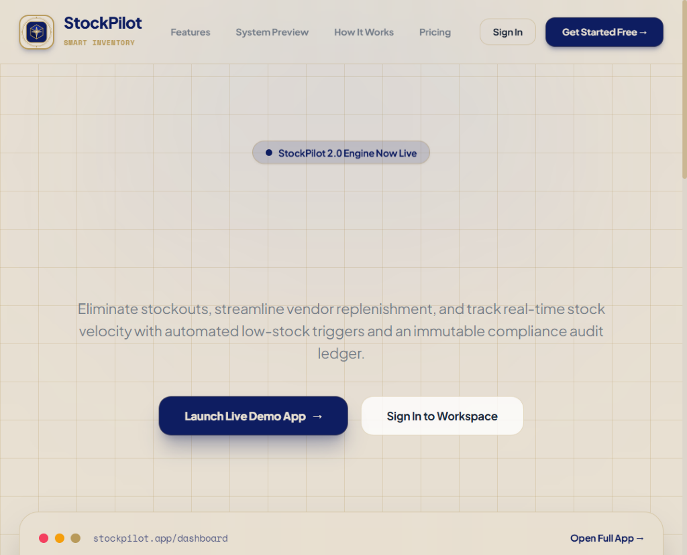
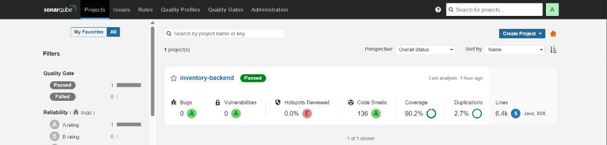

<div align="center">
  
  <h1>StockPilot</h1>
  <p><strong>Distributed Inventory Control & Warehouse Orchestration Platform</strong></p>
  <p>ACID-compliant double-entry stock ledgers, 3D spatial bin mapping, predictive lead-time replenishment, inter-warehouse transfer state machines, and immutable compliance auditing.</p>

  <p>
    <a href="https://openjdk.org/"></a>
    <a href="https://spring.io/projects/spring-boot"></a>
    <a href="https://react.dev/"></a>
    <a href="https://www.postgresql.org/"></a>
    <a href="https://tailwindcss.com/"></a>
    <a href="https://junit.org/"></a>
  </p>
</div>

---

## Product Demo & Walkthrough

> **Demo Video:** _Drop a Loom / YouTube link or drag-and-drop an `.mp4` walkthrough directly here on GitHub._  
> **Interactive UI Tour:** Open [`frontend/prototypes/index.html`](./frontend/prototypes/index.html) in any browser to explore all **14 interlinked screens** with live KPI count-ups, SVG velocity charts, and ledger workflows without running a backend.

---

## Screenshots

| Executive Operations Dashboard | Product Catalog & Spatial Bins |
| :---: | :---: |
|  |  |

| Low-Stock Replenishment Alerts | Financial Valuation & Reports |
| :---: | :---: |
|  |  |

<details>
<summary><strong>Landing Page & Code Quality Report</strong></summary>




</details>

---

## Core Product & Engineering Capabilities

### 1. Master Catalog & 3D Spatial Bin Mapping (`Zone > Aisle > Rack > Bin`)
- Hierarchical 4-tier warehouse locator indexing every SKU to exact physical storage coordinates.
- Barcode-linked SKUs, dynamic Unit-of-Measure (UOM) conversions, batch/lot tracking, and **FEFO (First Expired, First Out)** sequencing.
- Per-bin spatial capacity validation to prevent over-allocation.

### 2. Atomic Double-Entry Stock Movement Ledger
- Inventory balances are never mutated in-place without an immutable compensating ledger entry (`STOCK_IN`, `STOCK_OUT`, `ADJUSTMENT`).
- **Pessimistic Concurrency Control:** Enforces `SELECT ... FOR UPDATE` row-level locking during concurrent order fulfillment to eliminate race conditions and phantom reads.
- Every transaction records `previousQty`, `resultingQty`, `deltaQty`, and a correlated `reasonReference`, with negative stock mathematically blocked at both database and service layers.

### 3. Dynamic Lead-Time Predictive Replenishment Engine
- Computes rolling Reorder Points (ROP) from empirical 30-day sales velocity, vendor lead times, and demand standard deviation:
  $$\text{ROP} = (\text{Rolling 30-Day Velocity} \times \text{Supplier Lead Time}) + \text{Dynamic Safety Stock}$$
- Scheduled background jobs (`@EnableScheduling`) evaluate stock health and surface actionable 1-click Purchase Order suggestions before stockouts occur.

### 4. Inter-Warehouse Transfer State Machine
- Governs multi-facility transfers across an explicit lifecycle:
  $$\text{INITIATED} \longrightarrow \text{APPROVED} \longrightarrow \text{IN\_TRANSIT} \longrightarrow \text{COMPLETED} \quad (\text{or } \text{CANCELLED})$$
- Deducts outbound stock into an **In-Transit Virtual Quarantine Node** upon dispatch, enforces dual-authorization approval, and atomically credits the destination facility on arrival scan.

### 5. Immutable Regulatory Audit Trail & Financial Valuation Engine
- Records discrete JSON diffs (`oldValue` vs `newValue`) inside isolated transactions (`PROPAGATION_REQUIRES_NEW`) for SOX, IFRS, and GAAP compliance.
- Supports **FIFO (First-In, First-Out)** and **AVCO (Weighted Average Cost)** asset valuation with one-click **PDF (OpenPDF)** and **Excel `.xlsx` (Apache POI)** exports.
- Role-Based Access Control (`ADMIN`, `MANAGER`, `WAREHOUSE_STAFF`) with stateless JWT + OAuth2 (Google & GitHub) authentication.

---

## Architecture & Technical Stack

```text
┌──────────────────────────────────────────────────────────────────┐
│                 StockPilot Frontend (React 19 + Vite 8)          │
│   Dashboard  |  Catalog  |  Stock Ledger  |  Alerts  |  Reports  │
└─────────────────────────────────┬────────────────────────────────┘
                                  │ HTTPS / REST (JWT + X-Correlation-Id)
                                  ▼
┌──────────────────────────────────────────────────────────────────┐
│               Spring Boot 4 REST API (/api/v1, Java 21)          │
│   Spring Security (JWT/OAuth2)  |  Services  |  @Scheduled Jobs  │
└─────────────────────────────────┬────────────────────────────────┘
                                  │ Spring Data JPA / JDBC + Flyway (V1–V15)
                                  ▼
┌──────────────────────────────────────────────────────────────────┐
│                        PostgreSQL 16 Database                    │
│     Products  |  Stock Ledger  |  Warehouses  |  Audit Trail     │
└──────────────────────────────────────────────────────────────────┘
```

| Layer | Technologies |
| :--- | :--- |
| **Backend** | Java 21, Spring Boot 4.0.6, Spring Security 6, JJWT 0.12.6, Spring Data JPA / JDBC, Flyway (`V1`–`V15`), Lombok |
| **Exports & Docs** | OpenPDF 2.0.2 (PDF statements), Apache POI 5.3.0 (Excel `.xlsx` workbooks) |
| **Frontend** | React 19.2, Vite 8.0, React Router 7.15, Axios 1.15, Tailwind CSS 4.3, `@react-oauth/google` |
| **Design System** | Cartographic Field Notes palette (`#E8E0D2` Warm Ivory, `#B89A5A` Antique Gold, `#0E1D61` Deep Atlas Navy) with `Plus Jakarta Sans` & `Space Mono` |
| **Database & CI** | PostgreSQL 16, H2 (test profile), GitHub Actions (`.github/workflows/ci.yml`), Docker / Nginx, JaCoCo 0.8.12, SonarQube |

---

## Project Structure

```text
stockpilot/
├── .github/workflows/ci.yml        # Automated CI pipeline (Maven verify + Vite lint/build)
├── assets/
│   ├── screenshots/                # Application UI screenshots
│   ├── sonarqube_report.png        # Static analysis quality gate report
│   └── stockpilot_logo.jpg         # Official brand emblem
├── frontend/
│   ├── prototypes/                 # 14 standalone interactive HTML/Tailwind/JS screens
│   ├── public/                     # SVG brand marks & favicons
│   ├── src/
│   │   ├── components/             # BrandLogo, Sidebar, Navbar, MainLayout, Notifications
│   │   ├── context/                # AuthContext (JWT + Google/GitHub OAuth)
│   │   ├── pages/                  # Dashboard, Products, Stock, Alerts, Reports, AuditTrail, etc.
│   │   └── services/               # Axios API client with JWT & correlation ID interceptors
│   ├── Dockerfile
│   ├── nginx.conf
│   └── package.json
├── inventory-backend/
│   ├── src/main/java/com/stockiq/inventory/
│   ├── src/main/resources/
│   │   ├── application.yml
│   │   └── db/migration/postgresql/ # Flyway migrations V1 through V15
│   ├── src/test/                   # JUnit 5 + Mockito unit & integration tests
│   ├── Dockerfile
│   ├── docker-compose.yml
│   └── pom.xml
├── .env.example                    # Environment variable template
├── CONTRIBUTING.md                 # Contribution & PR workflow
└── LICENSE                         # MIT License
```

---

## API Reference (Core Endpoints)

| Method | Endpoint | Description | Access |
| :--- | :--- | :--- | :--- |
| `POST` | `/api/v1/auth/register` | Register user / organization account | Public |
| `POST` | `/api/v1/auth/login` | Authenticate and issue JWT bearer token | Public |
| `GET` | `/api/v1/dashboard/summary` | Real-time KPI metrics, velocity trends, and distribution | Authenticated |
| `GET` | `/api/v1/products` | Paginated catalog with SKU/category/status filters | Authenticated |
| `POST` | `/api/v1/products` | Create product with SKU, pricing, and reorder threshold | Authenticated |
| `POST` | `/api/v1/stock/move` | Atomic stock movement (`STOCK_IN`, `STOCK_OUT`, `ADJUSTMENT`) | Authenticated |
| `GET` | `/api/v1/stock/history` | Immutable double-entry ledger history | Authenticated |
| `GET` | `/api/v1/stock/alerts` | Predictive low-stock alerts & suggested POs | Authenticated |
| `POST` | `/api/v1/transfers` | Initiate inter-warehouse stock transfer | Manager / Admin |
| `PUT` | `/api/v1/transfers/{id}/approve` | Approve transfer and move goods to transit quarantine | Admin |
| `PUT` | `/api/v1/transfers/{id}/complete` | Complete transfer at destination warehouse | Staff / Admin |
| `GET` | `/api/v1/reports/inventory` | Inventory valuation & supplier performance report | Authenticated |
| `GET` | `/api/v1/reports/inventory/export` | Export report as PDF or Excel (`.xlsx`) | Authenticated |
| `GET` | `/api/v1/audit-trail` | Paginated regulatory audit log with JSON diffs | Admin |

---

## Getting Started

### Prerequisites
- **JDK 21+** (Eclipse Adoptium / OpenJDK)
- **Node.js 20+** and **npm 10+**
- **PostgreSQL 16** (or Docker)

### 1. Environment Configuration
Copy the example environment file and configure your local database and JWT secret:
```bash
cp .env.example .env
```

| Variable | Description |
| :--- | :--- |
| `DB_URL` / `DB_USERNAME` / `DB_PASSWORD` | PostgreSQL JDBC connection URL and credentials |
| `JWT_SECRET` / `JWT_EXPIRATION_MS` | 256-bit HMAC signing key and token TTL (`86400000` ms) |
| `CORS_ALLOWED_ORIGINS` | Allowed frontend origins (`http://localhost:5173`) |
| `GOOGLE_CLIENT_ID` / `GITHUB_CLIENT_ID` | Optional OAuth2 client credentials (`VITE_*` for frontend) |

### 2. Start PostgreSQL
```bash
docker run --name stockpilot-postgres \
  -e POSTGRES_DB=inventory_db \
  -e POSTGRES_USER=postgres \
  -e POSTGRES_PASSWORD=postgres \
  -p 5432:5432 -d postgres:16-alpine
```

### 3. Run the Backend (`inventory-backend/`)
```bash
cd inventory-backend
./mvnw spring-boot:run
```
API server runs at `http://localhost:8080/api/v1`.

### 4. Run the Frontend (`frontend/`)
```bash
cd frontend
npm ci --legacy-peer-deps
npm run dev
```
Web app runs at `http://localhost:5173`.

---

## Testing & Verification

```bash
# Backend unit & integration tests + JaCoCo coverage report
cd inventory-backend
./mvnw clean verify

# Frontend lint & production build
cd ../frontend
npm run lint
npm run build
```

---

## Contributing & License

Contributions are welcome — see [CONTRIBUTING.md](./CONTRIBUTING.md) for branching, environment setup, and PR verification guidelines.

Licensed under the [MIT License](./LICENSE).
